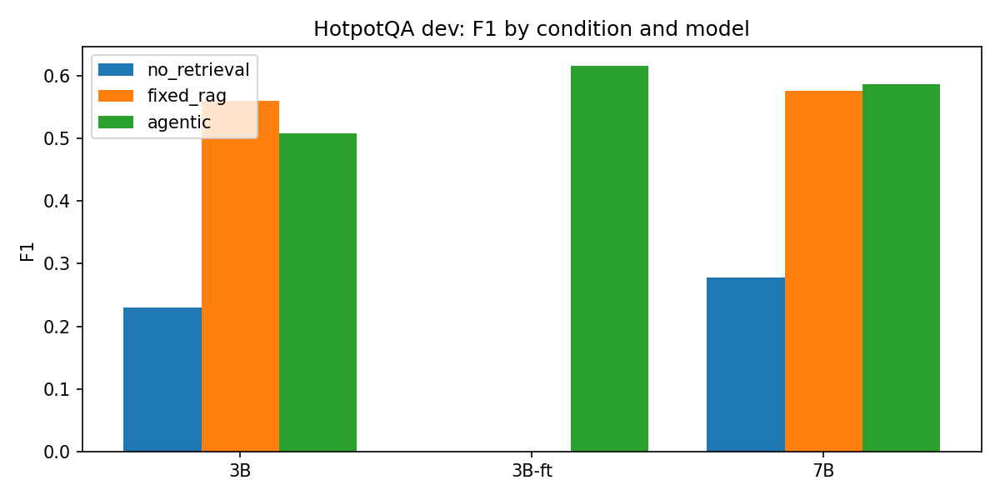

# Agentic RAG Failure Analysis, Model Benchmark & Tool Calling

An end-to-end Kaggle research pipeline for measuring how small language models retrieve evidence, use tool calls, and fail on multi-hop question answering. The project compares three answering strategies, builds a failure taxonomy, and tests whether filtered teacher traces can teach a 3B model a more reliable retrieval loop.



## What this project studies

The same questions and retrieval index are evaluated under three conditions:

1. **No retrieval** — the model answers from its parametric knowledge.
2. **Fixed RAG** — one retrieval call returns a fixed set of passages before answering.
3. **Agentic RAG** — the model decides when to search, writes a query, reads the observation, and either searches again or finishes.

The agent must emit exactly one JSON tool call per turn:

```json
{"tool": "search", "query": "an entity-specific query"}
```

or:

```json
{"tool": "finish", "answer": "short answer"}
```

The benchmark records answer quality, retrieval recall, tool-call validity, formatting, completion rate, and one primary failure label for every trace.

## Main findings from `run1`

F1 is the mean token-overlap answer score; all results below use the exact models and sample sizes in [`results/RESULTS.md`](results/RESULTS.md).

| Dataset | Model | No retrieval | Fixed RAG | Agentic | Agentic + QLoRA |
|---|---:|---:|---:|---:|---:|
| HotpotQA dev | Qwen2.5-3B | 0.231 | 0.560 | 0.508 | **0.616** |
| HotpotQA dev | Qwen2.5-7B | 0.278 | 0.576 | **0.587** | — |
| MuSiQue | Qwen2.5-3B | 0.085 | 0.177 | 0.200 | **0.295** |
| MuSiQue | Qwen2.5-7B | 0.128 | 0.226 | **0.309** | — |
| 2WikiMultihopQA | Qwen2.5-3B | 0.220 | 0.388 | 0.325 | **0.487** |
| 2WikiMultihopQA | Qwen2.5-7B | 0.256 | 0.449 | 0.400 | — |

The 3B adapter improves agentic F1 over the base 3B model by **+0.108** on HotpotQA, **+0.095** on MuSiQue, and **+0.162** on 2WikiMultihopQA. Paired bootstrap confidence intervals and the full metric table are in [`results/RESULTS.md`](results/RESULTS.md).

These are controlled research comparisons, not open-domain leaderboard scores: the retriever indexes the pooled distractor paragraphs belonging to the sampled questions rather than a full Wikipedia corpus.

## Method

```text
HotpotQA / MuSiQue / 2WikiMultihopQA
                 │
                 ▼
      unified question + paragraph format
                 │
                 ▼
 BGE-small dense index ──► no retrieval / fixed RAG / agentic RAG
                                      │
                                      ▼
                           JSON traces + failure tags
                                      │
                         7B teacher trace generation
                                      │
                    clean + correct + retrieved-gold filter
                                      │
                                      ▼
                   Qwen2.5-3B 4-bit QLoRA fine-tuning
                                      │
                                      ▼
                    in-domain and out-of-domain evaluation
```

### Configuration used for `run1`

- **Models:** `Qwen/Qwen2.5-3B-Instruct` and `Qwen/Qwen2.5-7B-Instruct`, loaded in 4-bit NF4; 7B supplies teacher traces.
- **Retriever:** `BAAI/bge-small-en-v1.5`, cosine similarity, agentic `top_k=3`, fixed-RAG `k=5`.
- **Agent budget:** at most six assistant turns, with deterministic greedy generation.
- **Training:** 2,000 HotpotQA train questions, clean teacher traces filtered for `F1 >= 0.8`, at least one search, no invalid/forced finish, and full gold-title recall; two-epoch LoRA/QLoRA adapter training.
- **Evaluation:** 500 HotpotQA dev questions and 300 questions from each out-of-domain set.

### Failure taxonomy

Each agentic trace receives one primary label: `correct`, `invalid_format`, `no_finish_loop`, `redundant_query`, `premature_answer`, `retrieval_miss`, or `reasoning_error`. The distribution is available in [`results/failure_taxonomy.csv`](results/failure_taxonomy.csv) and visualized in [`results/figures/fig2_failures.png`](results/figures/fig2_failures.png).

## Repository layout

```text
.
├── notebooks/
│   └── agentic_rag_failure_analysis_model_benchmark_tool_calling.ipynb
├── results/
│   ├── RESULTS.md              # generated report for run1
│   ├── results_summary.csv     # metrics by dataset/model/condition
│   ├── failure_taxonomy.csv    # agentic failure shares
│   ├── figures/                # generated plots
│   ├── logs/                   # QLoRA training log
│   └── traces/                 # JSONL traces for all published evaluations
├── artifacts/
│   └── README.md               # policy for heavyweight checkpoints
├── requirements.txt
└── README.md
```

## Reproduce the experiment on Kaggle

The notebook is designed for a CUDA Kaggle session rather than a CPU-only local run.

1. Open or upload [`notebooks/agentic_rag_failure_analysis_model_benchmark_tool_calling.ipynb`](notebooks/agentic_rag_failure_analysis_model_benchmark_tool_calling.ipynb) in Kaggle.
2. Enable Internet and a GPU. A T4 x2 or P100 is recommended.
3. Run the installation and configuration cells. Set `SMOKE_TEST = True` for a small end-to-end validation; use `False` for the full run.
4. Choose stages in `CFG["STAGES"]`: `tune`, `base_eval`, `traces`, `finetune`, `ft_eval`, `ablate`, and `report`.
5. Run the notebook. It writes resumable files under `working/outputs/<run>/` and skips completed trace files.
6. Read the generated `RESULTS.md` first. The final report cell also creates an output zip.

The notebook installs its runtime dependencies in the first cell. [`requirements.txt`](requirements.txt) documents the same high-level environment for reference; GPU-enabled PyTorch should be installed according to the target CUDA environment.

## Data and model sources

- [HotpotQA distractor](https://huggingface.co/datasets/hotpotqa/hotpot_qa) — primary training and evaluation dataset.
- [Salesforce ContextualBench](https://huggingface.co/datasets/Salesforce/ContextualBench) — MuSiQue and 2WikiMultihopQA generalization evaluation.
- [Qwen2.5 Instruct](https://huggingface.co/Qwen) — base and teacher language models.
- [BGE-small-en-v1.5](https://huggingface.co/BAAI/bge-small-en-v1.5) — dense retrieval encoder.

Dataset, model, and upstream license terms remain applicable. Review them before redistributing derived data or checkpoints.

## Limitations and responsible interpretation

- The pooled paragraph corpus makes retrieval easier than searching all of Wikipedia; compare conditions within this experiment rather than quoting the scores as open-domain performance.
- Results use sampled subsets and greedy decoding, so they are not a substitute for repeated-seed or statistical benchmark studies.
- A failure tag is a priority-ordered diagnostic label, not a complete causal explanation.
- The fine-tuned adapter is intentionally not committed here because its approximately 120 MB weights file exceeds GitHub's standard per-file limit. See [`artifacts/README.md`](artifacts/README.md).

## Citation

If you use this implementation or the published run artifacts, cite the repository:

```bibtex
@misc{agentic_rag_failure_analysis,
  title  = {Agentic RAG Failure Analysis, Model Benchmark and Tool Calling},
  author = {Anurag Singh},
  year   = {2026},
  url    = {https://github.com/anuragsinghmusics-wq/Agentic-RAG-Failure-Analysis-Model-Benchmark-Tool-Calling}
}
```
